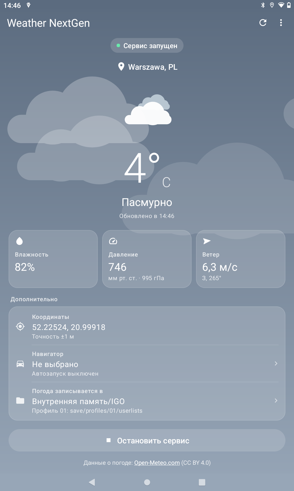
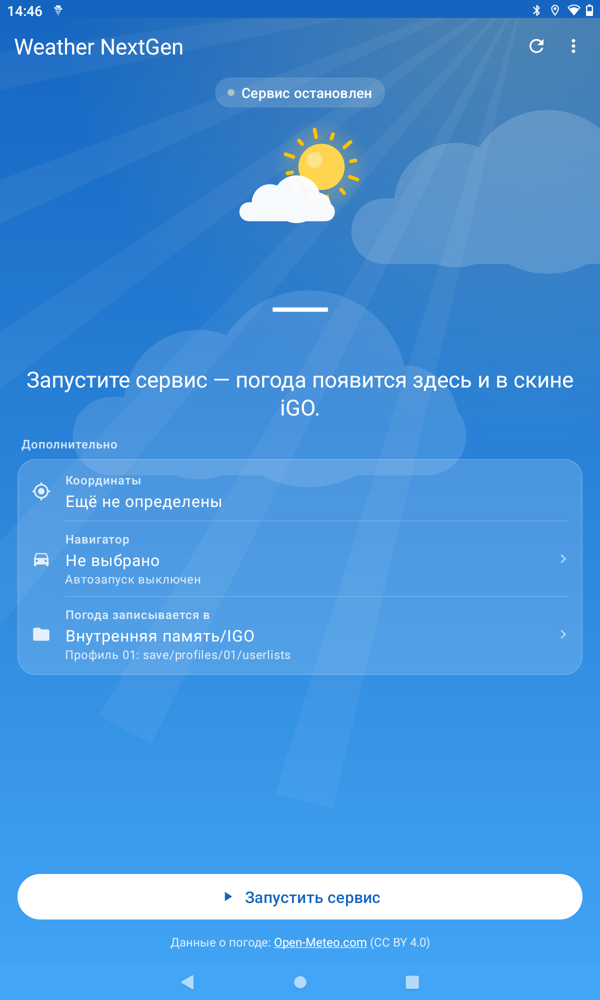
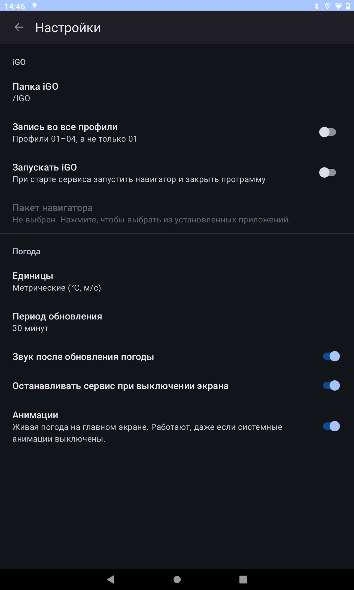

# Weather NextGen

Android-сервис, который показывает текущую погоду в навигаторе **iGO** (Primo, NextGen, Pioneer AVIC и другие сборки) через совместимый скин.

Сервис периодически узнаёт погоду в точке, где вы находитесь, и записывает её в профиль iGO. Если скин передаёт координаты точки назначения маршрута, туда же записывается погода в пункте назначения.

> *English:* an Android service that writes the current weather (and the weather at the route destination) into the iGO navigator profile, so a compatible skin can display it. Weather data comes from [Open-Meteo](https://open-meteo.com), no API key required. Android 5.0+.

## Скриншоты

<table>
  <tr>
    <td align="center"><br>Погода</td>
    <td align="center"><br>До запуска</td>
    <td align="center"><br>Настройки</td>
  </tr>
</table>

## Возможности

- **Погода с [Open-Meteo](https://open-meteo.com):** бесплатно, без регистрации и ключа API, по HTTPS.
- **Погода в точке назначения:** читается из `coordinates_fin.txt`, результат пишется в `weather_fin.txt`.
- **Запись в профиль 01 или сразу во все профили 01–04.**
- **Единицы:** метрические (°C, м/с) или имперские (°F, миль/ч).
- **Период обновления** от 10 минут до 3 часов.
- **Второй значок «Weather сервис»:** одним нажатием запускает сервис и навигатор.
- **По желанию:** звук после каждого обновления и остановка сервиса при выключении экрана.
- **Современный экран:** Material 3, фон и анимированная картинка меняются вместе с погодой (дождь, снег, звёзды, облака, гроза), карточки влажности, давления и ветра. Отдельный макет для горизонтальных экранов магнитол.
- **Дополнительная информация на главном экране:** координаты с точностью, выбранный навигатор и папка, куда записывается погода.
- **Языки интерфейса:** русский и английский. Описание погоды выводится на языке системы.

## Требования

- **Android 5.0 или новее.** Работает и на старых автомагнитолах, и на современных телефонах.
- **Доступ к местоположению.** Нужен, чтобы знать, где вы находитесь.
- **Интернет.**
- **Скин iGO, который умеет показывать погоду** из `weather.txt`.

## Установка и настройка

1. Установите APK.
2. Откройте **Настройки → Папка iGO** и выберите папку навигатора — ту, в которой лежит папка `save`. Например, `iGO_avic` на карте памяти.
3. Если хотите, чтобы навигатор запускался вместе с сервисом, включите **«Запускать iGO»** и выберите пакет своей сборки iGO.
4. Нажмите **«Запустить сервис»** и разрешите доступ к местоположению и уведомлениям.

Пока сервис работает, в шторке висит уведомление с текущей погодой. Без такого уведомления Android 8 и новее останавливает фоновые сервисы.

## Файлы для скина

Все файлы лежат в `save/profiles/NN/userlists/` и записаны в кодировке **UTF-16**.

| Файл | Кто пишет | Формат | Пример |
|---|---|---|---|
| `weather.txt` | сервис | `температура;иконка.svg;описание;id` | `-3°C;13n.svg;Снег;601` |
| `coordinates_fin.txt` | скин | `широта;долгота` (`0;0` — маршрута нет) | `55.7558;37.6173` |
| `weather_fin.txt` | сервис | `температура;иконка.svg;место` | `4°C;04n.svg;Moscow, RU` |

Имена иконок (`01d` … `50n`) и коды погоды (`id`) совпадают с [OpenWeatherMap](https://openweathermap.org/weather-conditions). Поэтому скины, сделанные для версий 1.x, продолжают работать без изменений.

Когда сервис останавливается, оба файла с погодой очищаются, чтобы скин не показывал устаревшие данные.

## Сборка

Нужны JDK 17 и Android SDK (платформа 35).

```bash
./gradlew assembleDebug
```

```bash
./gradlew testDebugUnitTest lintDebug
```

APK появится в `app/build/outputs/apk/debug/`. Для release-сборки задайте свою подпись в `app/build.gradle.kts`.

## Что изменилось в 2.1

- **Новый главный экран:** Material 3, градиентный фон под текущую погоду, анимированная картинка погоды и погода на весь экран (дождь, снег, звёзды, облака, туман, гроза).
- **Карточки** влажности, давления и ветра; стрелка ветра показывает, куда он дует.
- **Карточка «Дополнительно»:** координаты, выбранный навигатор и папка записи погоды.
- **Одна кнопка** «Запустить / Остановить сервис» и обновление жестом вниз.
- **Горизонтальный макет** для магнитол: погода и кнопка слева, подробности справа.
- **Анимации работают, даже если системные анимации выключены;** их можно отключить в настройках.

## Что изменилось в 2.0

Версия 2.0 полностью переписана на Kotlin под современный Android:

- **Источник погоды:** Open-Meteo вместо закрытого Weather Underground и OpenWeatherMap.
- **Доступ к папке iGO:** через системное окно выбора папки, поэтому запись работает и на Android 10+.
- **Исправлены:** падения без интернета, утечки памяти и файлов, путаница единиц измерения.
- **Что больше не поддерживается:** остановка сервиса после закрытия iGO (современный Android не даёт это отследить), единицы в Кельвинах и переводы, кроме русского и английского.

Версия 2.0 подписана другим ключом, чем 1.x, поэтому обновить «поверх» не получится: удалите версию 1.x и установите 2.0 заново. Настройки придётся задать снова.

## Источник данных

Данные о погоде: [Open-Meteo.com](https://open-meteo.com), лицензия [CC BY 4.0](https://creativecommons.org/licenses/by/4.0/).

## Лицензия

Код распространяется по лицензии [MIT](LICENSE). Данные о погоде, которые приложение получает от Open-Meteo, остаются под лицензией CC BY 4.0.
